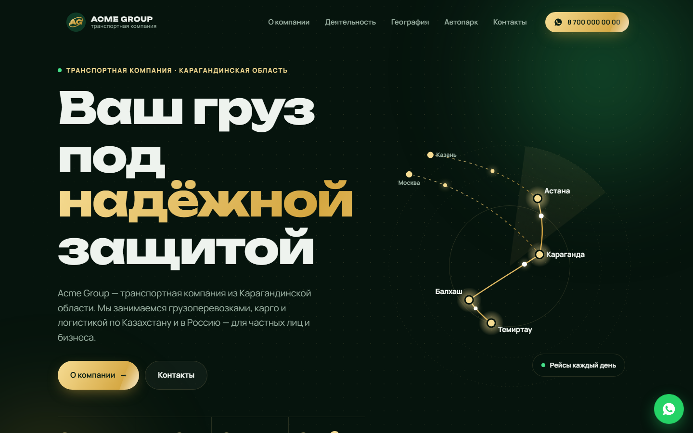

# Acme Group — logistics company landing page

A one-page corporate website for a regional freight & moving company: dark green/gold design, animated route map, fleet showcase and one-tap WhatsApp contact. Pure HTML/CSS/JS, deployable as a static site (e.g. Vercel / any static hosting).



## Features

- **Hero with animated SVG route map** — city nodes, glowing dots and dashed long-haul routes; display typography (Unbounded + Manrope).
- Preloader, scroll progress bar, sticky blurred navigation, mobile burger menu, cursor glow.
- **Animated counters** (`data-to`) and reveal-on-scroll via `IntersectionObserver`; 3D tilt cards; infinite city marquee.
- Sections: about, services (cargo, intercity to Russia, home/office/country moves, consolidated cargo), geography (daily routes + long-haul), fleet cards with capacity, values, business life, contacts.
- **WhatsApp-first contact** — floating button and contact cards built from a single `WA` number constant in `script.js`.
- Respects `prefers-reduced-motion`; semantic markup, ARIA labels, Open Graph meta.

## Tech stack

HTML5 · CSS3 (custom properties, grid, gradients, keyframes) · vanilla JavaScript · inline SVG · Google Fonts.

## Project structure

```
index.html    markup (all sections, inline SVG map and icons)
styles.css    design system + layout + animations
script.js     preloader, nav, counters, reveal, tilt, WhatsApp links
favicon.svg   placeholder "AG" monogram
docs/screenshot.png
```

## How to run (demo mode)

Nothing to install — open `index.html`, or:

```bash
python -m http.server 8000    # → http://localhost:8000
```

> All data in this repository is randomly generated; brand names are anonymized. "Acme Group", its monogram, phone numbers, social handles, region and routes are fictional/placeholders.

## Қысқаша (KZ)

Жүк тасымалдау және көшу қызметтерін ұсынатын аймақтық компанияға арналған бір беттік корпоративтік сайт.
Анимацияланған маршрут картасы, автопарк, есептегіштер, WhatsApp арқылы жылдам байланыс.
Тек HTML/CSS/JS — `index.html` файлын браузерде ашу жеткілікті.
Компания атауы, телефондар мен байланыс деректері ойдан шығарылған.
